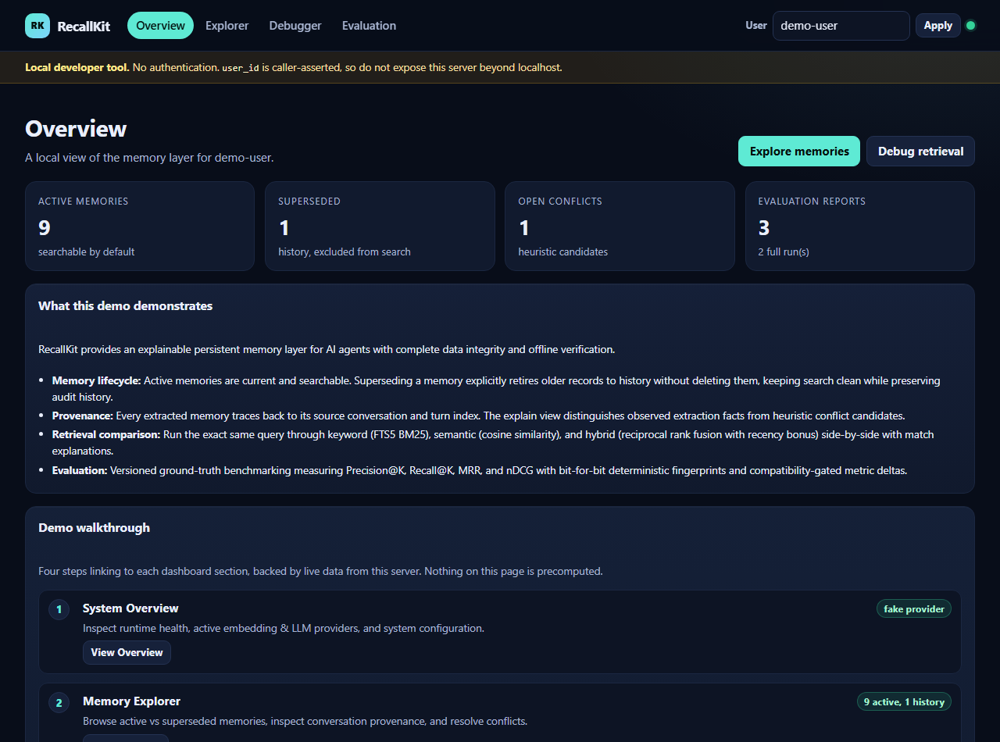
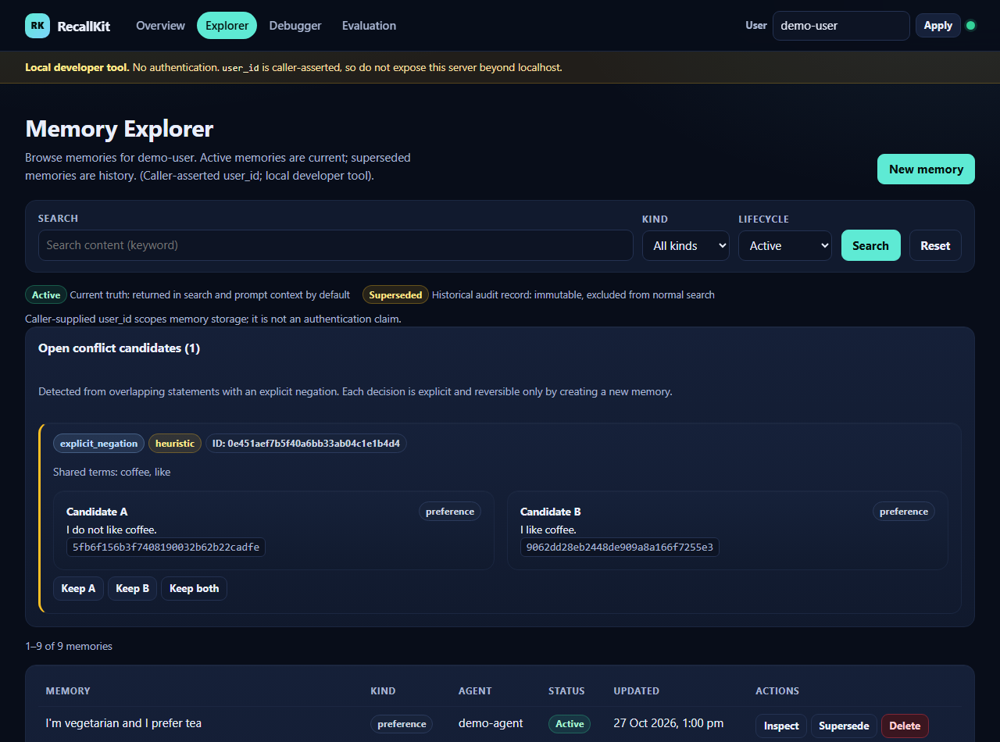
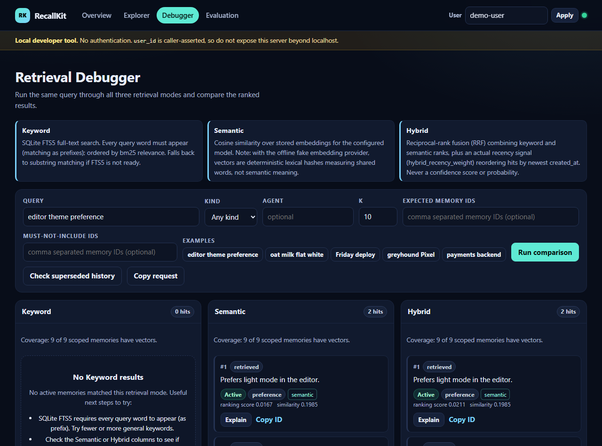
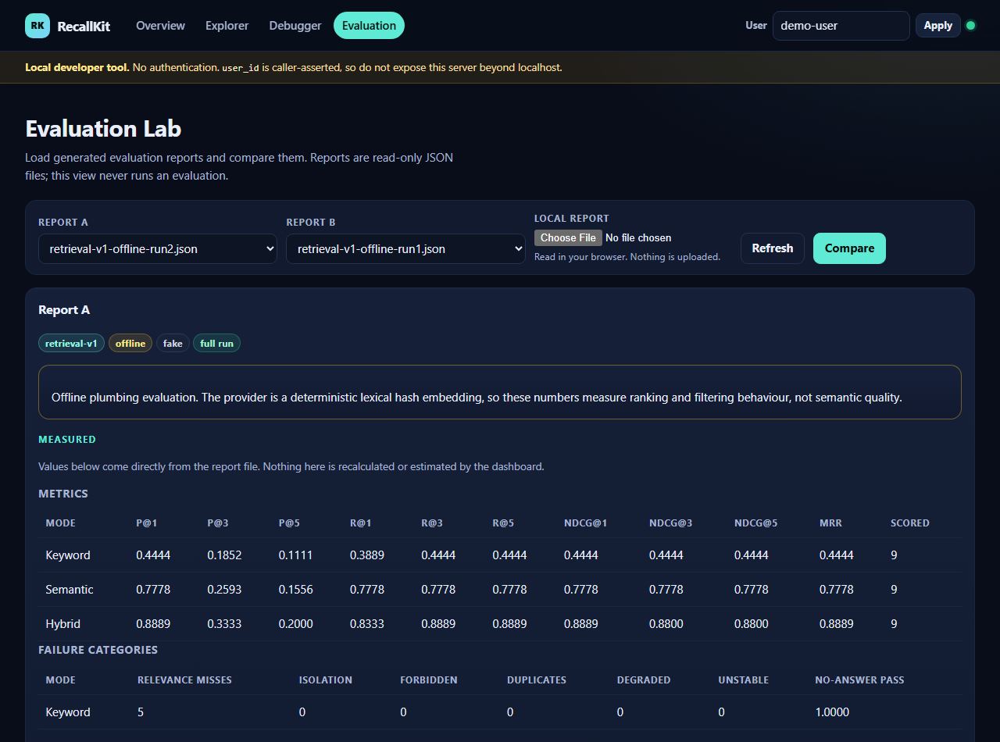

# RecallKit

> An inspectable memory layer for AI agents.

RecallKit is a transparent, explainable memory layer for AI agents built with Python, FastAPI, and SQLite. It extracts durable facts and preferences from multi-turn conversations, links every record to its exact provenance, resolves contradicting updates through explicit lifecycle states, and ranks retrieval with hybrid keyword + vector search — all inspectable in real time via an embedded, dependency-free developer dashboard.

Targeted at developers building autonomous agents and conversational assistants, RecallKit replaces opaque vector stores with an inspectable system where memory decisions, superseded facts, candidate conflicts, and retrieval scores are fully visible, auditable, and testable offline.

---

## At a Glance

- **Deterministic & Offline-First**: Zero mandatory API keys, external SaaS dependencies, or vector databases. Runs locally on standard SQLite with deterministic fakes for embeddings and fact extraction. Pluggable to any OpenAI-compatible `/v1/embeddings` and `/v1/chat/completions` endpoint.
- **Verifiable Provenance**: Every extracted memory references its source conversation ID and exact message indexes.
- **Explicit Lifecycle & Supersession**: Newer statements don't silently overwrite older ones; superseded facts are preserved for historical audit while filtered from default search.
- **Heuristic Conflict Review**: Automatically flags opposing statements (e.g., *"prefers dark mode"* vs *"prefers light mode"*) for explicit resolution (*Keep A*, *Keep B*, or *Keep Both*).
- **Hybrid Retrieval & Explainability**: Reciprocal Rank Fusion (RRF) combining SQLite FTS5 (BM25) and cosine similarity with recency re-ranking. The API and UI explicitly report `matched_by`, vector coverage, and score contributions.
- **Ground-Truth Evaluation Lab**: Built-in evaluation harness measuring Precision@K, Recall@K, MRR, and nDCG against versioned ground-truth datasets with deterministic SHA-256 report fingerprinting.
- **Dependency-Free Dashboard**: Pure vanilla HTML, CSS, and ES modules served directly by the FastAPI process. No `npm`, node build step, external CDNs, or third-party tracking.

---

## Visual Product Tour

| System Overview | Memory Explorer |
| :---: | :---: |
| [](docs/screenshots/overview.png) | [](docs/screenshots/explorer.png) |
| *Live health metrics, active/superseded counts, and guided demo walkthrough with query chips.* | *Lifecycle badges, provenance links, searchable supersession picker, and conflict resolution.* |

| Retrieval Debugger | Evaluation Lab |
| :---: | :---: |
| [](docs/screenshots/debugger.png) | [](docs/screenshots/evaluation.png) |
| *Side-by-side comparison across Keyword, Semantic, and Hybrid modes with diagnostic classifications.* | *Versioned benchmark inspection, metric deltas, failure category audits, and offline caveats.* |

---

## The Problem: Why Inspectable Memory Matters

Most AI agent memory architectures suffer from three fatal flaws:

1. **The Vector Black Box**: When an agent retrieves the wrong memory, there is no way to diagnose why. Cosine similarity offers no visibility into why a particular chunk ranked higher than another, or whether a critical keyword was ignored.
2. **Silent Contradictions & Amnesia**: When a user changes their preference (e.g. *"I switched from Python to Go"*), naive vector systems store both memories. Retrieval then randomly returns either the current preference or the obsolete one depending on phrasing.
3. **Missing Auditability & Provenance**: Agents hallucinate facts, but developers cannot tell whether the agent hallucinated during extraction or retrieved an incorrect chunk. Without verified conversation references, human-in-the-loop debugging is impossible.

RecallKit solves this by making memory state **structured, inspectable, and lifecycle-aware**:
- Current state is separated from history (`active` vs `superseded`).
- Extracted memories retain foreign keys to their exact conversation receipts.
- Opposing statements generate candidate conflicts for review.
- Search signals are combined using rank fusion, returning transparent breakdown metadata (`matched_by`, cosine similarity, and RRF score).

---

## Guided Demo Walkthrough

The embedded dashboard (<http://127.0.0.1:8000/dashboard/>) provides a four-step walkthrough:

1. **System Overview (`#/overview`)**:
   - Inspect live memory counts, superseded history counts, open conflict candidate counts, and available evaluation reports.
   - Click verified demo query chips (`editor theme preference`, `oat milk flat white`, `Friday deploy`, `greyhound Pixel`, `payments backend`) to launch prefilled queries directly into the Debugger.
2. **Memory Explorer (`#/explorer`)**:
   - Browse active and superseded memories with kind filters (`fact`, `preference`, `event`, `task`).
   - Click **Inspect** to review observed conversation provenance and message positions.
   - Resolve open conflicts using **Keep A**, **Keep B**, or **Keep Both**.
   - Supersede a memory using the interactive candidate picker, previewing both old and replacement content before confirming.
3. **Retrieval Debugger (`#/debugger`)**:
   - Execute queries simultaneously across **Keyword (FTS5)**, **Semantic (cosine)**, and **Hybrid (RRF + recency)**.
   - Inspect hit counts, vector coverage, raw cosine similarities, and relative RRF ranking scores.
   - Test diagnostic assertions with optional **Expected IDs** and **Forbidden IDs**, classifying results into *expected*, *forbidden*, *foreign_user*, *unexpected*, and *missing*.
4. **Evaluation Lab (`#/evaluation`)**:
   - Review versioned evaluation runs without rerunning computations.
   - Compare two reports side-by-side with automated compatibility checks (verifying identical dataset SHA-256, K values, and evaluated query subsets).
   - Inspect metric deltas alongside explicit warnings regarding offline lexical limitations.

---

## Architecture & Data Flow

RecallKit follows a layered, decoupled architecture with strict data boundaries:

```mermaid
flowchart TD
    subgraph Client ["Client & Agent Layer"]
        Agent[Agent / LLM App]
        User[Developer Browser]
    end

    subgraph API ["FastAPI Routers (app/api)"]
        R_Health["GET /health"]
        R_Memories["/memories (CRUD, Supersede, Explain)"]
        R_Search["POST /memories/search"]
        R_Convs["POST /conversations"]
        R_Conflicts["/memory-conflicts"]
        R_Dash["/dashboard (Static UI & Report Reader)"]
    end

    subgraph Services ["Domain Services (app/services)"]
        MS[MemoryService]
        SS[SearchService]
        CS[ConversationService]
        CFS[ConflictService]
        ES[ExplainService]
        SUPS[SupersessionService]
        RRF[Reciprocal Rank Fusion]
    end

    subgraph Providers ["Pluggable Providers (app/llm)"]
        LLM_P{LLM Provider}
        EMB_P{Embedding Provider}
        FakeLLM[Rule-Based Heuristic Extractor]
        FakeEmb[Deterministic Lexical Hash Vectorizer]
        OpenAI_LLM["OpenAI /v1/chat/completions"]
        OpenAI_Emb["OpenAI /v1/embeddings"]
    end

    subgraph Storage ["SQLite Storage (app/repositories)"]
        DB[(recallkit.db WAL mode)]
        T_Mem[memories table]
        T_FTS[memories_fts FTS5]
        T_Emb[memory_embeddings]
        T_Conv[conversations & receipts]
        T_Src[memory_sources]
        T_Conf[memory_conflicts]
        T_Msg[conversation_messages]
    end

    subgraph EvalEngine ["Evaluation Lab (app/evaluation)"]
        Dataset[Versioned Dataset JSON]
        Runner[Evaluation Runner]
        Metrics[Precision, Recall, MRR, nDCG]
        Reports[Deterministic Report JSON]
    end

    Agent -->|HTTP/JSON| R_Memories
    Agent -->|HTTP/JSON| R_Search
    Agent -->|HTTP/JSON| R_Convs
    User -->|HTTP/HTML| R_Dash
    User -->|REST| R_Conflicts

    R_Memories --> MS
    R_Memories --> SUPS
    R_Memories --> ES
    R_Search --> SS
    R_Convs --> CS
    R_Conflicts --> CFS

    CS --> LLM_P
    MS --> EMB_P
    SS --> EMB_P
    SS --> RRF

    LLM_P --> FakeLLM
    LLM_P --> OpenAI_LLM
    EMB_P --> FakeEmb
    EMB_P --> OpenAI_Emb

    MS --> DB
    SS --> DB
    CS --> DB
    CFS --> DB
    SUPS --> DB

    Runner --> Dataset
    Runner --> SS
    Runner --> Metrics
    Metrics --> Reports
    R_Dash -.-> Reports
```



### Architectural Principles

- **Zero SQL in Routers**: Routers only handle request parsing, dependency injection, and HTTP status codes.
- **SQL Scoping by User ID**: Every database query explicitly filters by `user_id` in the `WHERE` clause, ensuring zero accidental cross-user leakage.
- **No In-Server Schema Migrations**: The server checks `PRAGMA user_version` on startup and refuses to start if migrations are pending. Migrations are strictly explicit CLI operations.
- **Unpacked Float Vectors in SQLite**: Vectors are stored as little-endian `float32` BLOBs. Cosine similarity runs via efficient standard library unpacking without heavy external vector dependencies.

---

## Technology Stack

- **Backend**: Python 3.11+ (tested on Python 3.14), FastAPI, Uvicorn, Pydantic v2, Pydantic-Settings.
- **Database**: SQLite 3 with FTS5, WAL (Write-Ahead Logging), and immediate transactions.
- **Dashboard**: Vanilla JavaScript (ES2022 modules), native CSS variables, responsive design (390px, 768px, 1280px). Zero npm packages, zero external CDNs.
- **Evaluation**: Custom ground-truth evaluation engine with deterministic SHA-256 fingerprinting.
- **Code Quality**: Ruff (linter and formatter), Pytest, DevTools Chrome DevTools Protocol (CDP) for browser regression tests.

---

## Repository Structure

```
recallkit/
├── app/
│   ├── main.py                     # FastAPI application factory & lifespan
│   ├── config.py                   # Pydantic settings & environment configuration
│   ├── db.py                       # SQLite connection management & PRAGMA guards
│   ├── models.py                   # API request & response schemas
│   ├── cli.py                      # CLI commands: init, migrate, seed-demo, evaluate
│   ├── api/                        # REST endpoint routers
│   │   ├── memories.py             # CRUD, supersede, and explain
│   │   ├── search.py               # Ranked multi-mode search
│   │   ├── conversations.py        # Ingestion & fact extraction
│   │   ├── conflicts.py            # Conflict review & resolution
│   │   └── dashboard.py            # Static asset mounting & report reader
│   ├── repositories/               # SQLite database access layer
│   │   ├── memories.py             # Memory CRUD & status filtering
│   │   ├── search.py               # FTS5 & LIKE search queries
│   │   ├── embeddings.py           # Float32 BLOB vector storage
│   │   ├── conversations.py        # Conversation receipts & idempotency
│   │   └── conflicts.py            # Conflict candidate storage
│   ├── services/                   # Core business logic
│   │   ├── memory_service.py       # ID generation, validation, CRUD
│   │   ├── search_service.py       # Keyword, semantic, and RRF hybrid retrieval
│   │   ├── conversation_service.py # Ingestion pipeline orchestration
│   │   ├── extraction.py           # Prompt formatting & output parsing
│   │   ├── conflict_service.py     # Negation & lexical conflict detection
│   │   └── supersession.py         # Explicit memory retirement
│   ├── llm/                        # Pluggable model providers
│   │   ├── base.py                 # Protocol interfaces
│   │   ├── fake.py                 # Deterministic offline fakes
│   │   ├── openai_compatible.py    # OpenAI / Ollama / vLLM client
│   │   └── factory.py              # Provider factory from settings
│   ├── migrations/                 # Versioned schema migrations
│   │   ├── runner.py               # Transactional migration engine
│   │   └── 0001_memory_lifecycle.sql
│   └── evaluation/                 # Retrieval evaluation engine
│       ├── dataset.py              # Schema validation & integrity
│       ├── runner.py               # Evaluation execution pipeline
│       ├── metrics.py              # Precision, Recall, MRR, nDCG
│       └── report.py               # JSON report generator & fingerprinting
├── dashboard/                      # Developer dashboard frontend
│   ├── index.html                  # Dashboard HTML shell
│   └── assets/                     # Vanilla JS modules & CSS stylesheets
├── docs/                           # Documentation assets
│   └── screenshots/                # Real dashboard product screenshots
├── eval/                           # Evaluation assets
│   ├── datasets/retrieval-v1.json  # 13-query synthetic ground truth
│   └── reports/                    # Baseline evaluation reports
├── scripts/                        # Automation & testing scripts
│   ├── dashboard_browser_check.mjs # DevTools CDP browser regression check
│   ├── capture_screenshots.py      # Automated genuine screenshot capture runner
│   └── capture_screenshots.mjs     # CDP screenshot capture automation
├── tests/                          # 515+ offline pytest test suite
├── schema.sql                      # Baseline SQLite schema
├── pyproject.toml                  # Pytest & Ruff configuration
├── requirements.txt                # Pinned production runtime dependencies
└── requirements-dev.txt            # Pinned development & testing dependencies
```

---

## Setup Guide (Windows PowerShell)

### 1. Environment & Dependencies

```powershell
# Clone and enter directory
cd recallkit

# Create and activate virtual environment
python -m venv .venv
.\.venv\Scripts\Activate.ps1

# Upgrade pip and install development dependencies
python -m pip install --upgrade pip
python -m pip install -r requirements-dev.txt
```

*Note: If PowerShell script execution is restricted on your machine, run commands directly via the virtual environment's executable:*
```powershell
.\.venv\Scripts\python.exe -m pip install -r requirements-dev.txt
```

### 2. Configuration

Copy the example environment configuration:
```powershell
Copy-Item .env.example .env
```
RecallKit runs completely offline by default using deterministic fakes (`RECALLKIT_EMBEDDING_PROVIDER=fake`, `RECALLKIT_LLM_PROVIDER=fake`). No external API keys are required.

To use real embeddings or an LLM, configure `.env`:
```ini
RECALLKIT_EMBEDDING_PROVIDER=openai_compatible
RECALLKIT_EMBEDDING_API_KEY=your-api-key-here
RECALLKIT_EMBEDDING_MODEL=text-embedding-3-small
RECALLKIT_EMBEDDING_DIMENSIONS=1536

RECALLKIT_LLM_PROVIDER=openai_compatible
RECALLKIT_LLM_API_KEY=your-api-key-here
RECALLKIT_LLM_MODEL=gpt-4o-mini
```

---

## Safe Demo Walkthrough

Run a complete, verified demo using an isolated temporary database. **This never modifies or overwrites your primary database:**

```powershell
# 1. Point to an isolated temporary database in TEMP
$env:RECALLKIT_DATABASE_PATH = "$env:TEMP\recallkit-demo.db"

# 2. Initialize schema and seed verified demo records
.\.venv\Scripts\python.exe -m app.cli init
.\.venv\Scripts\python.exe -m app.cli seed-demo --user-id demo-user

# 3. Generate a baseline evaluation report for the Evaluation Lab
.\.venv\Scripts\python.exe -m app.cli evaluate --dataset eval/datasets/retrieval-v1.json --output eval/reports/retrieval-v1-offline-run1.json

# 4. Start the server
.\.venv\Scripts\python.exe -m uvicorn app.main:app --reload
```

Open <http://127.0.0.1:8000/dashboard/> in your browser.

When finished, clean up the temporary database:
```powershell
Remove-Item "$env:TEMP\recallkit-demo.db*" -Force -ErrorAction SilentlyContinue
Remove-Item Env:\RECALLKIT_DATABASE_PATH -ErrorAction SilentlyContinue
```

---

## Testing & Quality Assurance

RecallKit is verified against a comprehensive automated test suite:

### 1. Unit & Integration Tests (Offline)
```powershell
.\.venv\Scripts\python.exe -m pytest -q
```
*Expected: 517 passed, 2 skipped (browser tests opt-in; symlink test skipped on Windows).*

### 2. Opt-In Browser Regression Tests
Verifies dashboard responsiveness across 390px, 768px, and 1280px viewports, tests query comparisons, and checks for zero console errors using Edge/Chromium via CDP:
```powershell
$env:RECALLKIT_BROWSER_TESTS = "1"
.\.venv\Scripts\python.exe -m pytest tests/test_dashboard_browser.py -q
```

### 3. Linting & Formatting
```powershell
.\.venv\Scripts\ruff.exe check
.\.venv\Scripts\ruff.exe format --check
```

### 4. JavaScript Syntax Validation
Verify all 9 vanilla JS and MJS modules for ES2022 syntax correctness:
```powershell
Get-ChildItem -Path dashboard/assets, scripts -Include *.js, *.mjs -Recurse | ForEach-Object { node --check $_.FullName }
```

### 5. Automated Screenshot Capture
Regenerate genuine documentation screenshots using a fresh temporary database:
```powershell
.\.venv\Scripts\python.exe -m scripts.capture_screenshots
```

---

## Retrieval Evaluation & Benchmarks

RecallKit includes a native retrieval evaluation engine (`app/evaluation`) inspired by TREC/BEIR evaluation methodologies. It scores precision, recall, mean reciprocal rank (MRR), and normalized discounted cumulative gain (nDCG) across all retrieval modes against versioned datasets.

### Measured Ground-Truth Results (`eval/datasets/retrieval-v1.json`)

Evaluated on 13 queries across 12 memories and 2 users using K ∈ {1, 3, 5}:

| Mode | P@1 | P@3 | P@5 | R@1 | R@3 | R@5 | MRR | NDCG@1 | NDCG@3 | Scored | Misses |
| :--- | :---: | :---: | :---: | :---: | :---: | :---: | :---: | :---: | :---: | :---: | :---: |
| **Keyword (FTS5)** | 0.4444 | 0.1852 | 0.1111 | 0.3889 | 0.4444 | 0.4444 | 0.4444 | 0.4444 | 0.4444 | 9 | 5 |
| **Semantic (Cosine)** | 0.7778 | 0.2593 | 0.1556 | 0.7778 | 0.7778 | 0.7778 | 0.7778 | 0.7778 | 0.7778 | 9 | 2 |
| **Hybrid (RRF + Recency)** | **0.8889** | **0.3333** | **0.2000** | **0.8333** | **0.8889** | **0.8889** | **0.8889** | **0.8889** | **0.8800** | 9 | **1** |

- **Integrity Violations**: 0 across all modes (zero cross-user leakage, zero forbidden hits, zero duplicate results).
- **Abstention on Empty Targets**: 100% pass rate (2 out of 2 queries with no relevant answer correctly returned zero results).

### Crucial Benchmark Caveat

> **Important**: The benchmark figures above were generated using RecallKit's offline deterministic fake embedding provider (`recallkit-fake-hash-v1-256`). This provider hashes words and n-grams into a fixed-dimension vector to measure lexical overlap.
>
> While this guarantees 100% deterministic testing and validates pipeline mechanics (ranking algorithms, reciprocal rank fusion, coverage calculation, and isolation boundaries), **it does not measure semantic understanding or synonym awareness** (e.g. *"oat milk"* will not match *"dairy alternative"* under the fake provider).
>
> The 13-query synthetic dataset is designed as an indicative plumbing verification tool, not an industry-wide benchmark. To evaluate genuine semantic retrieval, run the evaluation command with an external embedding provider:
> ```powershell
> .\.venv\Scripts\python.exe -m app.cli evaluate --dataset eval/datasets/retrieval-v1.json --provider configured --allow-external-provider
> ```

---

## API Reference

| Method | Endpoint | Description |
| :--- | :--- | :--- |
| `GET` | `/health` | Service health status and SQLite connection check |
| `POST` | `/memories` | Create a new memory (`user_id`, `content`, `kind`, `agent_id`) |
| `GET` | `/memories` | List memories with pagination, search, kind, and status filters |
| `GET` | `/memories/{id}` | Retrieve memory details by ID |
| `PATCH` | `/memories/{id}` | Update content or kind of an active memory (409 if superseded) |
| `DELETE` | `/memories/{id}` | Permanently delete a memory and its associated vectors |
| `POST` | `/memories/{id}/supersede` | Explicitly retire a memory in favor of a replacement memory |
| `GET` | `/memories/{id}/explain` | Return observed extraction provenance and candidate conflicts |
| `POST` | `/memories/search` | Ranked search across active memories (`keyword`, `semantic`, `hybrid`) |
| `POST` | `/conversations` | Ingest multi-turn chat and extract durable facts with idempotency |
| `GET` | `/memory-conflicts` | List detected open or resolved memory conflict candidates |
| `POST` | `/memory-conflicts/{id}/resolve` | Resolve conflict with `keep_a`, `keep_b`, `keep_both`, or `superseded` |
| `POST` | `/memory-conflicts/scan` | Re-scan active memories for contradictory statements |
| `GET` | `/dashboard/` | Developer dashboard interface |

---

## Security Disclosures & Known Limitations

- **Caller-Asserted User Identity**: RecallKit does not provide an authentication layer (OAuth, JWT, API tokens). The `user_id` parameter is asserted by the caller. RecallKit is intended for local development or internal backend service-to-service communication behind an authenticated API gateway.
- **Local Developer Dashboard**: The dashboard is intended strictly for localhost development. It has no access control or user authentication. Do not bind the server to `0.0.0.0` or expose the dashboard on untrusted networks.
- **Data Retention & Privacy Deletion**: Calling `DELETE /memories/{id}` deletes the memory record, its vector embeddings, and its search index entries. However, it does not purge the historical receipt in `conversations.result_json` or raw messages (if `RECALLKIT_STORE_MESSAGES=true` is enabled).
- **Prompt Injection Defense**: Memories stored in RecallKit are stored as raw text. Applications injecting recalled memories into downstream LLM prompts must sanitize or format memory content to protect against indirect prompt injection.
- **Vector Search Scale**: Vector search performs an in-memory brute-force cosine similarity scan over candidate embeddings. This is optimal for low-latency personal agent memory (up to ~5,000 memories per user), but larger datasets will require an embedded vector extension (such as `sqlite-vec`).

---

## Project Status & Roadmap

RecallKit is a solo-built project created for a startup/product hackathon. All foundational milestones (M1 through M3.6) are complete and verified.

Planned future enhancements:
- [ ] JWT / OAuth2 bearer token authentication and role-based access control.
- [ ] Native vector indexing integration via `sqlite-vec` for scaling beyond 10,000 vectors per user.
- [ ] Conversation scrubbing and GDPR-compliant retention purge endpoints.
- [ ] Python and TypeScript client SDKs for agent frameworks (LangChain, LlamaIndex, CrewAI).

---

## Contributing & License

Contributions, feedback, and issue reports are welcome. Please open an issue or pull request adhering to the existing code standards (100% type annotations, Ruff formatting, and comprehensive pytest coverage).

**License Status**: No open source license has been selected yet. All rights reserved. (A standard permissive open source license such as MIT or Apache-2.0 will be selected prior to public distribution).
